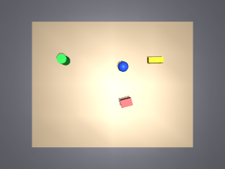
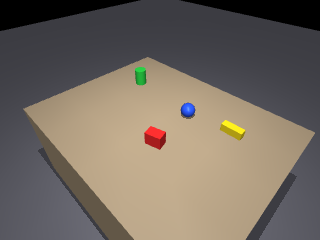
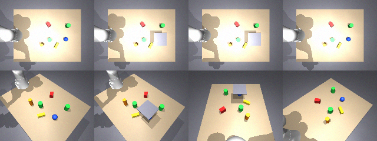

# BELIEF-3D

**Belief-space 3D perception and risk-aware active vision for robust robotic manipulation**,
built on MuJoCo. Simulation only.

The research question: when object pose is ambiguous (occlusion, symmetry, bad depth,
calibration drift), does picking camera views by *expected grasp failure under a calibrated
multimodal pose belief* beat information-gain view selection at equal budgets? This is a
hypothesis. Prior work that overlaps with it is listed in
[`docs/literature_review.md`](docs/literature_review.md).

## Status

**M0–M5 complete; M6 in progress.** Simulation only. Every result below comes from a
held-out test split, with the method frozen first; most were pre-registered. See
[`EXPERIMENT_REGISTRY.md`](EXPERIMENT_REGISTRY.md).

| Milestone | Headline result |
|---|---|
| M2 classical perception | Sub-mm pose under nominal noise. Two-camera tracking MOTA 0.98–1.00. ~11.6 mm of error per degree of calibration drift. |
| M3 neural pose | Neural proposals + geometric refinement: success on < 50 %-visible objects 0.985 vs 0.853 for the classical fit, at half its time. The network alone is worse (0.735). |
| M4 belief tracking | **Pre-registered.** Multimodal SE(3) belief vs Kalman tracker. Rotation success on partly visible objects 64.8 % → 87.0 % (paired +0.27, p = 0.007); no MOTA loss. ~0.4 mm worse translation; ~5,000× slower. |
| M5 active vision (1) | **Pre-registered: H3 not supported.** Task-risk view selection ignoring calibration never moved and tied with fixed (0.49); *random* won (0.63). |
| M5 + self-calibration | **Pre-registered: confirmed.** Online extrinsic self-calibration from known objects across diverse views: 0.767 vs 0.640 without (+0.127, p = 0.003). A fixed camera shows exactly 0 effect, as predicted. Full system vs fixed camera: 0.513 → 0.767. |
| M5 active vision (2) | **Pre-registered: confirmed.** Calibration-aware task-risk: 0.667 vs 0.533 (entropy / covariance) and 0.520 (original), Holm p = 0.008. It picks views whose calibration biases cancel; ≈ random (+0.03, n.s.). |

The take-away so far: *a task-aware view objective helps only when its loss model contains the
error that actually limits the task* — here view-dependent calibration bias, not pose ambiguity.

## What the cameras see

| Overhead camera | Mobile camera |
|---|---|
|  |  |

Depth back-projected through the camera model lands within 0.3 mm of the true sphere surface
([EXP-M0-001](EXPERIMENT_REGISTRY.md)).

Controlled occlusion (EXP-M1-002). The top row is overhead, where the plate fully hides the
blue sphere. The bottom row is the mobile camera, which can still see it:



## Quickstart

```bash
python3.12 -m venv .venv && .venv/bin/pip install -e '.[dev]'
.venv/bin/python scripts/fetch_assets.py      # Franka Panda from MuJoCo Menagerie (pinned)
export MUJOCO_GL=cgl        # macOS; use egl or osmesa on Linux
export PYTHONPATH=.
.venv/bin/python -m pytest -q
.venv/bin/python scripts/m0_demo.py --seed 0
```

## Docs

- [Coordinate frames](docs/coordinate_frames.md): `T_AB` notation, OpenCV camera frame, quaternion order
- [Architecture](docs/architecture.md): modules and the inference/ground-truth leakage boundary
- [Research question](docs/research_question.md): hypotheses H1–H4 and the data protocol
- [Limitations](docs/limitations.md)

## License

MIT

## C++ kernels (optional)

The belief's free-space likelihood has a pybind11 port, which gives the same numbers and runs a
belief update 3.4× faster (PERF-M7-005):

```bash
cmake -S . -B cpp/build -DPython_EXECUTABLE=$(which python) && cmake --build cpp/build -j4
```

Use it with `BeliefConfig(fs_backend="cpp")`. Without the build, `tests/unit/test_cpp_kernels.py` skips.
